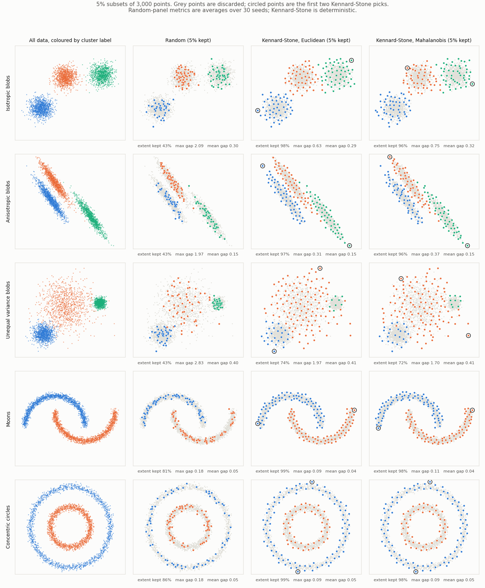
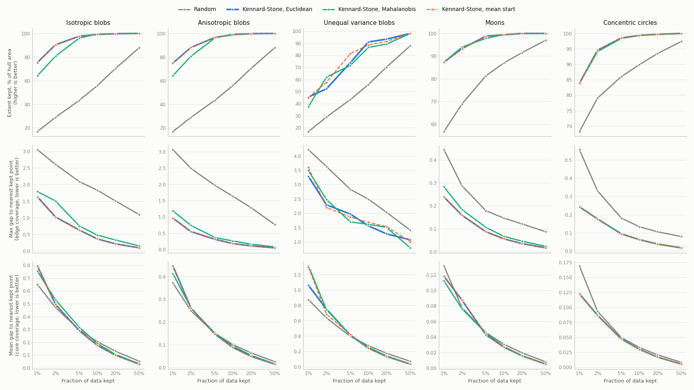
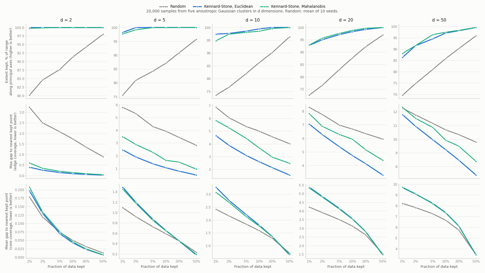
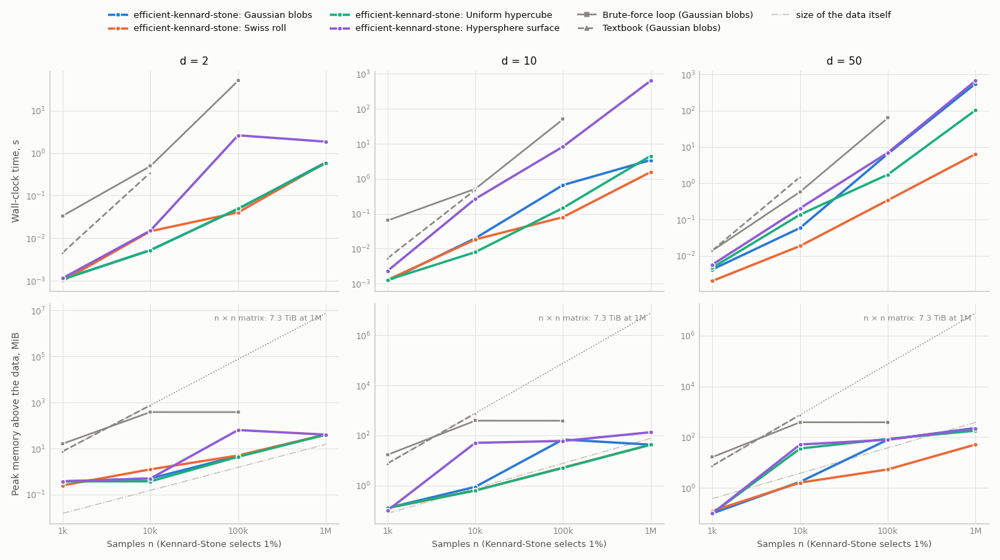
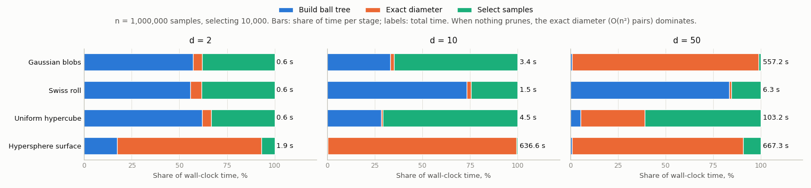

# efficient-kennard-stone

Exact, fast and memory-efficient Kennard-Stone sample selection for Python 3.9,
built to handle up to (and beyond) a million samples.

```python
import numpy as np
from efficient_kennard_stone import kennard_stone, train_test_split

X = np.random.default_rng(0).normal(size=(1_000_000, 5))

idx = kennard_stone(X, 10_000)          # rows of X, in selection order
idx, dist = kennard_stone(X, 10_000, return_distances=True)

X_train, X_test, y_train, y_test = train_test_split(X, y, test_size=0.2)
```

## What it computes

The classic Kennard-Stone algorithm (Kennard & Stone, 1969):

1. select the two samples that are farthest apart;
2. repeatedly select the sample whose distance to its nearest selected sample
   is largest.

The result is **identical to the textbook O(n²) implementation**, including
tie-breaking (ties go to the lowest row index). The test suite checks this
against a brute-force reference, including data with exact ties and
duplicates.

`kennard_stone(X, n_select=None, *, init="diameter", metric="euclidean", leaf_size=32, return_distances=False)`

| argument | meaning |
|---|---|
| `n_select` | number of samples to select (default: all, i.e. a full Kennard-Stone ordering) |
| `init` | `"diameter"` (classic), `"mean"` (start from the sample farthest from the mean), or explicit row indices to select first |
| `metric` | `"euclidean"` or `"mahalanobis"` (whitens the data first, which makes one float64 copy) |
| `leaf_size` | ball-tree leaf size; affects speed only, never the result |
| `return_distances` | also return each selected sample's distance to the samples selected before it (`inf` for the first) |

`train_test_split(*arrays, test_size=None, train_size=None, **kwargs)` uses
the scikit-learn size conventions. The training set is the Kennard-Stone
selection on the first array; the test set is everything else.

## How it is fast

A textbook implementation stores the n × n distance matrix: 8 TB for a
million samples. Even the usual O(n)-memory variant needs `n_select` full
passes over the data. This package instead:

* **Organises the samples in a ball tree** (scikit-learn's Cython `BallTree`,
  built in O(n log n)). Each node keeps the largest current "distance to the
  selected set" of its samples, so the next sample to select is read from the
  root.
* **Prunes with the triangle inequality.** A new selected sample can only
  shorten the distances of samples closer to it than their current value.
  Whole subtrees, and single samples via their distance to their leaf
  centroid, are skipped without reading their coordinates.
* **Batches the updates.** Up to 62 selected samples are buffered and applied
  in one parallel traversal (numba `prange`), so the work is compute-bound
  rather than one memory-bound pass per selection. Between batches, the
  candidate at the root is checked against the buffered samples only. If it
  is still the largest after that check, it is provably the exact
  Kennard-Stone choice.
* **Finds the diameter exactly with a pruned dual-tree search.** Node pairs
  whose distance upper bound cannot beat the best pair found so far are
  skipped. The bounds come from ball geometry and from distance to the mean,
  and the starting lower bound comes from repeated farthest-point sweeps.
  The search runs in parallel. If the bounds stop pruning, it switches to
  blocked BLAS brute force over the candidates that remain, ordered so that
  whole blocks can still be skipped.

Memory use is O(n + n_select) beyond the input: about 40 bytes per sample for
the tree and the selection state. `X` is never copied when it is a
C-contiguous float64 or float32 array. scikit-learn's `BallTree` makes a
temporary float64 copy of float32 input while the tree is built.

## Performance

Timings are for 1,000,000 samples, float64, on a 16-thread machine under WSL2
with numba's TBB threading layer. Wall-clock times include building the tree
and the exact diameter search, but not JIT compilation. Numba caches compiled
code on disk, so compilation happens only once per machine. "Extra memory" is
peak resident memory above the process's size after `X` was created.

| data | d | n_select | time | extra memory |
|---|---|---|---|---|
| Gaussian | 2 | 800,000 (80 %) | 5.5 s | 52 MB |
| uniform cube | 3 | 800,000 (80 %) | 7.2 s | 52 MB |
| Gaussian | 5 | 800,000 (80 %) | 44 s | 51 MB |
| 20 Gaussian blobs | 10 | 800,000 (80 %) | 100 s | not measured¹ |
| Gaussian | 10 | 800,000 (80 %) | 174 s | 48 MB |
| Gaussian, float32 | 10 | 800,000 (80 %) | 168 s | 20 MB |
| Gaussian | 10 | 10,000 | 5.4 s | 42 MB |
| Gaussian, float32 | 10 | 10,000 | 5.1 s | 19 MB |
| Gaussian | 20 | 1,000 | 4.9 s | 45 MB |
| Gaussian | 50 | 1,000 | 18 s (diameter 5.9 s) | 52 MB |
| Gaussian (`init="mean"`) | 50 | 1,000 | 13 s | 44 MB |

¹ Temporary arrays from generating that dataset set the peak, which hides the
algorithm's own usage. `examples/scaling.py` avoids this by loading cached
data in a fresh process.

When the tree bounds stop pruning (high intrinsic dimension), the exact
diameter search switches to a blocked float32 BLAS GEMM with exact float64
rechecks. On 100,000 i.i.d. Gaussian samples with d = 200, the diameter
takes 7.7 s (11 s in total).

For scale: one brute-force pass over 1M × 10 float64 samples costs about
1.6 ms on this machine (memory-bound), so the 800,000-selection runs above
would need about 20 minutes as a one-pass-per-selection loop. A textbook
implementation would need an 8 TB distance matrix.

## Examples

Three scripts in [`examples/`](examples) produce the figures below
(`pip install -e .[examples]`, then run them from the repository root).

### Subset quality on 2-D datasets: [`synthetic_datasets.py`](examples/synthetic_datasets.py)

These are the five 2-D datasets from scikit-learn's clustering comparison.
Each method keeps 5% of 3,000 points. Kennard-Stone starts from the two most
distant points (circled) and then fills the space evenly. It keeps 96–99% of
each cluster's convex-hull area, against 43–86% for a random subset of the
same size. The exception is the unequal-variance blobs (74%): spreading
points evenly over space gives most of the budget to the widest cluster, and
the two tight clusters get only a few points each.



The next figure shows coverage as the kept fraction varies, with the random
baseline averaged over 30 seeds. Kennard-Stone dominates on extent and on
max gap (the farthest any sample is from a kept one). Mean gap (core
coverage) is about the same as random: Kennard-Stone spends its budget evenly
over space rather than in proportion to density. The cheap `init="mean"`
start usually picks a diameter endpoint anyway, so its curve (dashed) mostly
lies on top of the classic one.



### Dimensionality: [`dimensions.py`](examples/dimensions.py)

This uses 20,000 samples from five anisotropic Gaussian clusters, with
d = 2 to 50. The advantage in extent and max gap holds in every dimension. As
d grows, Kennard-Stone's mean gap becomes larger than random's: in many
dimensions almost all of the volume is near the boundary, and that is where
Kennard-Stone's picks go.



### Run time, memory and worst cases: [`scaling.py`](examples/scaling.py)

This selects 1% of n samples for n = 1k to 1M and d = 2, 10, 50, on four
datasets:

* 20 Gaussian blobs (each blob fills all d dimensions);
* a Swiss roll rotated into d dimensions (low intrinsic dimension);
* a uniform hypercube and a hypersphere surface (high intrinsic dimension,
  the worst cases for pruning).

The hypersphere is also the worst case for the exact diameter: every point
is equally far from the mean and has a nearly diametral partner. Two
brute-force implementations serve as baselines: the textbook n × n matrix and
an O(n)-memory loop. The script checks that all three make identical
selections.

Results at one million samples, selecting 10,000:

* **Low intrinsic dimension is fast.** 0.6 s for every dataset in 2-D except
  the circle (1.9 s), 1.5–4.5 s at d = 10, and 6.3 s for the Swiss roll at
  d = 50.
* **Memory stays small.** Peak memory above the data is 40–230 MiB. A distance
  matrix would need 7.3 TiB.
* **Selection is never the bottleneck.** It takes at most 63 s, even when
  nothing prunes.
* **The exact diameter is the expensive step when nothing prunes.** This
  happens for the hypersphere surface at d = 10 and 50, and for 50-D Gaussian
  blobs (each blob fills all 50 dimensions). These take 9–11 minutes, almost
  all of it spent comparing up to 5 × 10¹¹ pairs with BLAS. For such data,
  `init="mean"` skips that search.

At 100,000 samples, the brute-force loop takes 50–63 s and the package
0.05–6.5 s on the same data.





## Limits

* Pruning works well when the data's *intrinsic* dimension is low to
  moderate, which is typical for descriptor or PCA-score data. For data that
  truly fill many dimensions (for example i.i.d. Gaussian with d ≥ ~20), the
  bounds prune little. Selection then falls back to near brute-force cost,
  O(n · n_select · d) but batched and parallel. The exact diameter needed by
  `init="diameter"` can then cost O(n² d), though it runs as BLAS GEMM:
  about 10 minutes at one million samples (see `examples/scaling.py`). For
  such data, consider `init="mean"` or running Kennard-Stone on PCA scores.
* Exactness is with respect to IEEE double arithmetic: distances are computed
  directly as `sqrt(sum((a - b)**2))` with float64 accumulation. Every
  pruning bound is loosened by a relative 1e-12, so rounding can never hide an
  update.

## Installation and environment

Requires Python 3.9 with numpy, scipy, scikit-learn and numba from the same
period (see `pyproject.toml`; developed and tested with numpy 1.23.5, scipy
1.9.3, scikit-learn 1.1.3 and numba 0.56.4).

```bash
pip install -e .[test]
pytest
```

**Install a fast threading layer for numba.** Without TBB or OpenMP, numba
falls back to its `workqueue` layer, which costs about 0.5 ms per parallel
region instead of about 20 µs. To use TBB:

```bash
pip install "tbb==2021.7.1"     # or: pip install -e .[tbb]
```

In a plain virtualenv the TBB wheel puts its library outside the loader path.
Importing this package loads it from `<sys.prefix>/lib` automatically. To
check which layer is in use, run any selection and then call
`numba.threading_layer()`. On Linux, the system `libgomp1` package enables the
OpenMP layer instead. Conda environments ship TBB or OpenMP on the loader
path already.

Benchmarks: `python benchmarks/bench.py N D N_SELECT [--data gauss|uniform|blobs] [--dtype float32]`.
